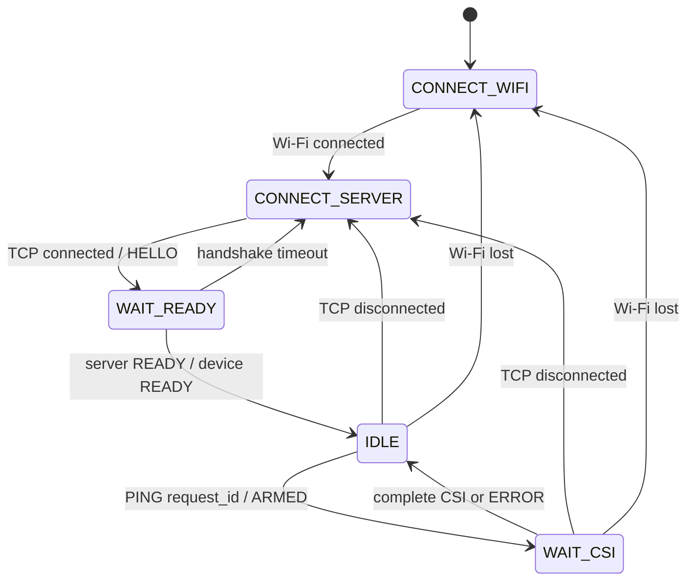

# CSI Collector: ESP32 request/response prototype

The ESP32 initiates a TCP connection to the computer. Python controls every
measurement. The firmware does not record labels, save files, or run models.
`Server/server.py` is left for the collection server; `Server/probe.py` is a
small diagnostic listener for checking the firmware on hardware.

## Configure and run

1. In `CollectCSI/include/local_config.h`, set `SERVER_HOST` to your computer's
   LAN IPv4 address. The existing sketch's Wi-Fi settings have been preserved in
   this ignored local file. For another checkout, copy `local_config.example.h`
   to `local_config.h` and enter the settings.
2. Edit `OUTPUT_FILENAME` and `SAMPLE_COUNT` at the top of `Server/probe.py`,
   then run `python Server/probe.py` from this directory.
   It listens on TCP port 5000. The computer and ESP32 must be able to communicate
   on the LAN; allow the listener through the firewall if prompted.
3. From `CollectCSI`, run `pio run -t upload` and open `pio device monitor`.
4. Each diagnostic request prints the entire JSON response and appends it to
   `Server/samples.jsonl` by default. Relative output filenames are resolved
   beside the script, even if you launch it from another directory. Existing
   contents are kept; choose a new filename for a separate recording.
   This diagnostic file is not yet the labeled localization dataset.

## Extract CSI to CSV

Edit `INPUT_FILENAME` and `OUTPUT_FILENAME` in `Data/csi_to_csv.py`, then run
`python Data/csi_to_csv.py`. Relative filenames resolve beside the converter.
It accepts the collector's JSON Lines recordings, a JSON array, or a single JSON
object. Each CSV row is one measurement, with columns
`img_0,real_0,img_1,real_1,...`. Metadata is excluded, and the raw signed bytes are
preserved in imaginary/real order. Existing output CSV contents are replaced.
Non-CSI responses are skipped; malformed or inconsistent CSI records fail before
the output is opened. Keep the source JSON for radio/validity metadata.

## Plot CSI spread

Run `python DataProcessing/plot_csi.py`. Edit the settings at the top to choose
CSV files and `MODE` (`individual`, `combined`, or `both`). Individual panels
show hexagonal density counts using all selected values. The combined view
shows a reproducible scatter sample colored by recording. Both use x=real,
y=imaginary, equal axis scaling, and common limits. Images are also saved in
`DataProcessing/plots`.

Set `CSI_PAIR_INDEX` to a zero-based pair number to compare the same CSI pair
across locations; leave it `None` to pool all pairs. Pooling can hide differences
between the full CSI fingerprints, and separation within one visit per point
does not establish performance on fresh visits. CSI pairs can span several LTF
blocks; the pair number is a buffer index, not necessarily a unique subcarrier.

For a dedicated single-pair view, edit `PAIR_INDEX` in
`DataProcessing/plot_csi_individual_pair.py` and run
`python DataProcessing/plot_csi_individual_pair.py`. It defaults to pair 10,
producing a combined scatter and four individual density panels. `MODE` chooses
either view or both. Images are saved as `plots/combined_pair_10.png` and
`plots/individual_pair_10.png` (with the selected index in the filename).

## Raw CSI classification

`DataProcessing/train_csi.py` is prepared for review. It uses each CSV filename as
the position label and every raw imaginary/real column as a feature. `MODE`
selects training or prediction; all filenames and parameters are editable at the
top. Executing the script in train mode starts training.

The default split uses the first 750 rows per existing 1000-row recording for
training, excludes 50 rows, and tests on the last 200 rows. Scaling is fit only
on training rows inside an RBF-SVM pipeline. The script saves the evaluated
pipeline, classification metrics, a confusion matrix, and per-row test
predictions under `DataProcessing/ml_results`. It does not refit on test rows.
Outputs are replaced when rerun. This evaluates separation within the existing
recordings, not generalization to independently collected visits.

After training, set `MODE = "predict"` and point `MYSTERY_CSV` to a new converted
recording. Prediction uses the saved scaler/model, checks feature names, and
saves per-row labels plus an aggregate vote summary. Agreement is not a
calibrated probability; labels express CSI resemblance, not physical distance.

## State machine



Initialization failure enters `FAULT` and logs the SDK error. Reconnection starts
a new session and clears pending requests. There is one outstanding measurement.

## Wire protocol, version 1

TCP is a byte stream: messages may be split across reads or combined in one read.
Commands are ASCII lines terminated by LF. Responses are one JSON object per LF
line. Python must consume the entire JSON line before issuing the next `PING`.
The diagnostic listener handles fragmented and combined responses.

```text
ESP32 -> server: {"type":"HELLO", ...}
server -> ESP32: READY\n
ESP32 -> server: {"type":"READY","schema_version":1}
server -> ESP32: PING 1\n
ESP32 -> server: {"type":"ARMED","request_id":1}
server -> ESP32: PROBE 1 <padding>\n
ESP32 -> server: {"type":"CSI","request_id":1, ...complete data...}
server -> ESP32: PING 2\n
```

`ARMED` is an intermediate acknowledgment, not the measurement response. Once
armed, Python can send padded `PROBE` lines (the diagnostic tool does so every
100 ms until a terminal response arrives). This generates downlink traffic
without starting another measurement. It does not wait for a separate PROBE
acknowledgment. A sample can arrive even before Python sends its first probe.

Each accepted `PING` ends with either `CSI` or `ERROR` with the same request ID,
unless the connection is lost. No CSI within two seconds produces `CSI_TIMEOUT`;
the server must never treat a timeout as a sample. On a transport failure the
server should reconnect and start a new session rather than wait indefinitely.

Request IDs are unsigned 32-bit decimal numbers, strictly increasing within a
connection. Retrying the last completed ID returns the cached terminal response
without collecting new data. Retrying the active ID repeats `ARMED`. A different
ID during capture returns `BUSY`. Older completed IDs return `STALE_REQUEST`.
Malformed/oversize command lines return errors with ID 0. Reconnect before IDs
wrap. PROBE commands have no terminal response of their own.

## What a measurement represents

This implements **one transaction -> one next eligible AP-frame measurement**.
It does not establish **one PING -> CSI of that exact PING's Wi-Fi frame**.
The CSI callback has no application request ID or payload. It selects the first
nonempty CSI callback from the connected AP after arming, which could correspond
to a probe, TCP traffic, or another AP frame. Ordinary ICMP ping is not this
application protocol. The frame carrying PING itself arrives before the command
handler arms capture. Filtering by the AP MAC excludes other transmitters but
does not identify a specific application packet.

Exact packet correlation would require additional frame-level instrumentation
and validation; do not use request IDs as evidence of that correlation. Every
response explicitly says `measurement_source: next_ap_frame_after_arm`.

## Complete response data

The response exports every named member of the installed SDK's `wifi_csi_info_t`
apart from its in-memory buffer pointer (the buffer contents are exported):

- `mac`, `first_word_invalid`, `len`, and all `len` signed CSI bytes in `csi`.
- All named S3 `rx_ctrl` fields: `rssi`, `rate`, `sig_mode`, `mcs`, `cwb`,
  `smoothing`, `not_sounding`, `aggregation`, `stbc`, `fec_coding`, `sgi`,
  `noise_floor`, `ampdu_cnt`, `channel`, `secondary_channel`, `timestamp`, `ant`,
  `sig_len`, and `rx_state`.
- `rx_ctrl_raw_hex`, retaining the SDK struct's raw bytes, including reserved
  bits. These bytes are SDK/target-specific, not a portable serialization format.
- CSI configuration, schema version, request ID, and sample-source semantics.
  HELLO identifies the SDK version and target for interpreting raw metadata.

Some metadata fields are reserved or meaningful only for certain packet modes;
exporting them does not make them valid features. CSI is interleaved signed
`imaginary, real` bytes. The first four bytes are retained even when flagged
invalid; preprocessing must mask them while preserving subcarrier indices.
No first-ten-values truncation, amplitude conversion, or normalization is applied.
All LTF types are enabled; LTF merging and channel smoothing are disabled.
Modem sleep is disabled to improve the precision of the device RX timestamp,
which is a wrapping local microsecond clock, not a wall-clock timestamp.
Samples beyond the 1024-byte capacity return `CSI_TOO_LARGE`, never truncated data.

The callback only copies data into a single-slot FreeRTOS queue. Serialization
and TCP writes happen in the main loop. A private generation token rejects stale
samples after a timeout/reconnection even when the server reuses a request ID.

## Validation

The firmware is built with PlatformIO for `freenove_esp32_s3_wroom`. A successful
build confirms compatibility with the installed Arduino/ESP-IDF headers, not
successful CSI acquisition on your router. Run the diagnostic listener on the
physical board to verify complete responses, timeouts, and reconnect behavior.
The host smoke checks exercise the diagnostic framing and validation code with
fragmented messages and connection failures; they do not emulate the radio.
Run them from this directory with
`python -m unittest discover -s Server -p test_probe.py -v`.

SDK reference: [ESP32-S3 CSI documentation](https://docs.espressif.com/projects/esp-idf/en/v4.4.7/esp32s3/api-guides/wifi.html#wi-fi-channel-state-information).
